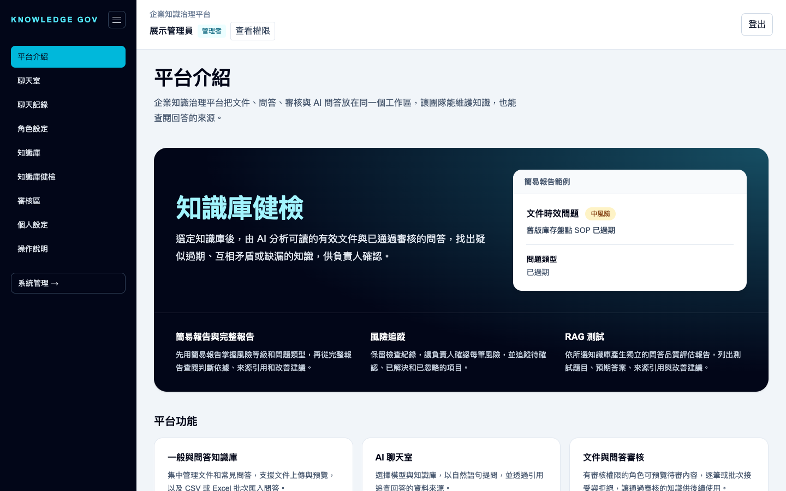
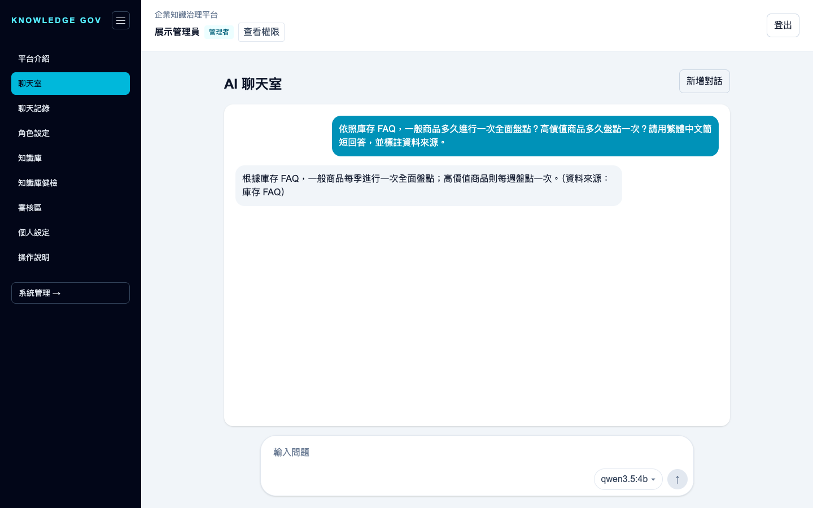
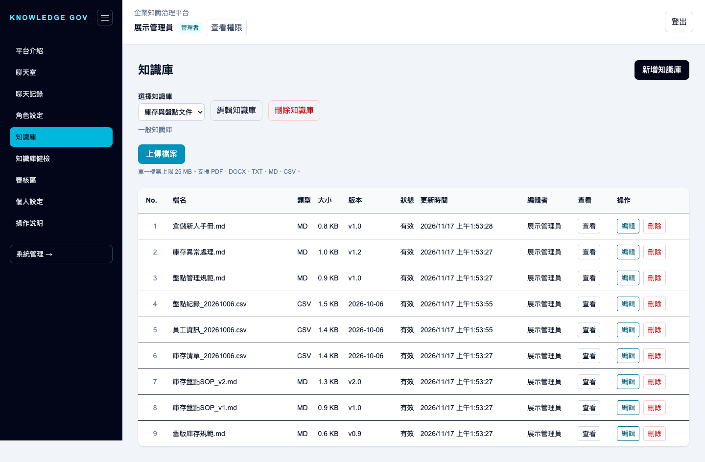
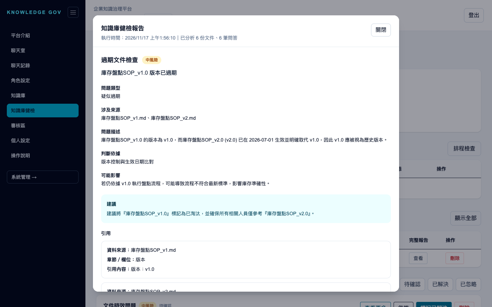
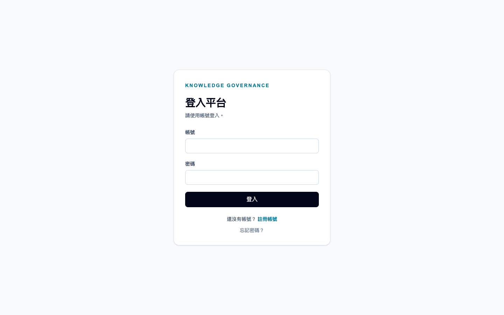
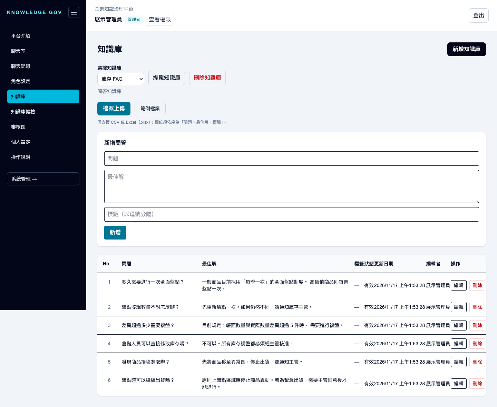
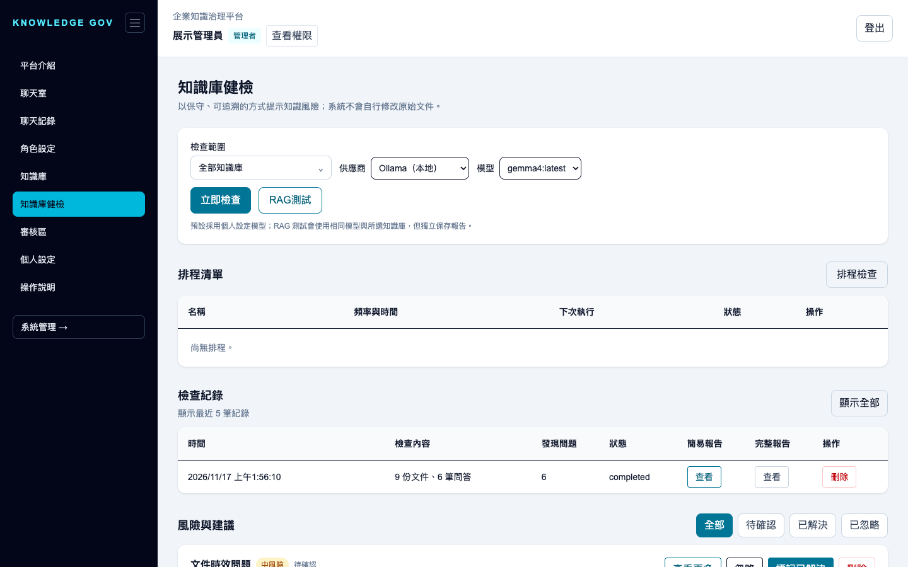

# 企業知識治理平台
**Enterprise Knowledge Governance Platform｜作品展示**

企業導入 RAG 知識庫後，內容仍會隨流程更新而過期，也可能出現版本衝突或資訊缺漏。本平台把文件與問答審核、附來源的 AI 對話，以及知識庫健檢放在同一個工作區，讓維護人員能從風險報告回查原文，再決定如何處理。

**主要技術**　Next.js 15、React 19、TypeScript、Tailwind CSS 4、Python 3.12、FastAPI、PostgreSQL 16


[展示影片（MP4）](docs/demo/enterprise-knowledge-governance-demo.mp4) · [健檢案例與測試結果](#測試與實際成果)

## 專案背景與發想動機

本專案源自 AI 人才培育計畫的專題實作，核心構想是用 AI 協助企業維護知識庫。企業導入 AI 後，常將內部 SOP、作業文件與常見問答整理成知識庫，供員工查詢。隨著制度與流程持續更新，新舊版本可能同時留存，問答與文件的說法也可能不一致，或缺少關鍵操作步驟。當 AI 引用過期或互相矛盾的內容，員工就可能依據不適用的資訊做判斷。

文件愈多，維護人員就愈難逐份核對版本、比對內容，並追蹤哪些問題已經處理。因此，平台以「知識庫健檢」為核心。文件與問答先經審核才納入檢索，健檢則結合文件規則與模型分析，找出可能過期、互相衝突或缺漏的內容。報告列出風險等級、來源引用與改善建議，讓維護人員能對照原文、安排修正並標記處理狀態。

## 核心功能

| 功能                 | 狀態     | 目前可操作的內容                                                                                                            |
| -------------------- | -------- | --------------------------------------------------------------------------------------------------------------------------- |
| 一般 AI 對話         | 已完成   | 選擇模型後即時接收串流回覆，可套用自訂 AI 角色提示詞並回看對話紀錄。                                                        |
| RAG 一般知識庫       | 部分完成 | 可上傳、預覽、管理版本與審核文件。生效的 TXT、MD、CSV 可供 RAG 檢索。PDF、DOCX 支援上傳與預覽，文字尚未納入檢索或模型健檢。 |
| RAG 問答型知識庫     | 已完成   | 維護「問題、最佳解、標籤」，支援 CSV、XLSX 批次匯入。問答通過審核後可供檢索，修改內容須重新送審。                           |
| 知識庫健檢           | 已完成   | 選擇範圍與模型執行健檢，查看簡易／完整報告及引用，並將風險標記為已解決或忽略。另有獨立的 RAG 品質測試報告功能。             |
| 健檢排程             | 部分完成 | 介面可設定排程，後端有處理到期排程的腳本。自動執行需由 cron 或其他外部排程工具觸發。                                        |
| 登入、角色權限與稽核 | 已完成   | 支援註冊、JWT 登入與權杖更新。管理員可管理帳號、設定自訂角色及功能權限，授權人員可查閱稽核紀錄。                            |
| 忘記密碼             | 部分完成 | 已有一次性權杖與密碼重設流程。開發環境可取得測試權杖，寄信服務尚未串接。                                                    |

文件與問答可逐筆或批次審核。知識庫對話可限定檢索範圍，找到相關內容時會要求模型標示來源，找不到可用來源時會明確回報。

## 系統展示

**[展示影片（MP4）](docs/demo/enterprise-knowledge-governance-demo.mp4)**。展示從文件預覽、FAQ 問答到健檢及核對引用的操作。影片標示加速的健檢等待區段。原始錄影可供核對。 [影片時間軸](docs/demo/demo-script.md) · [完整操作與等待](docs/demo/recording-workflow.webm) · [健檢風險詳情](docs/demo/recording-health-finding.webm)

> **展示資料附註**　員工測試 CSV 內的姓名、員工編號、到職日期及盤點權限，以及影片中 SOP 的公司名稱，均為使用 ChatGPT 模擬的虛構資料。 [員工測試 CSV](testdata/員工資訊_20261006.csv)

### 平台首頁

登入後的「平台介紹」提供聊天室、知識庫、審核與健檢的入口。



### AI 對話

選擇庫存 FAQ 提問，回覆列出一般商品與高價值商品的盤點頻率，並附上資料來源。



### 知識庫管理

一般知識庫集中顯示文件、版本與狀態，可開啟原文預覽。



### 知識庫健檢結果

風險詳情呈現舊版 SOP 的判斷依據、改善建議與文件引用，便於對照原文。



<details>
<summary>其他操作畫面</summary>

**登入頁**提供登入、註冊與忘記密碼入口。



**問答知識庫**支援逐筆編輯與批次匯入，列表顯示問答生效狀態。



**健檢工作區**可選擇知識庫與模型，並查看歷次檢查和風險狀態。



</details>

## 技術架構

| 層級        | 技術與用途                                                                                                                                         |
| ----------- | -------------------------------------------------------------------------------------------------------------------------------------------------- |
| 前端        | Next.js 15 App Router、React 19、TypeScript、Tailwind CSS 4。透過 Next.js 同源代理呼叫 FastAPI，聊天室使用 Server-Sent Events（SSE）接收串流。     |
| 後端        | Python 3.12、FastAPI、Uvicorn、Pydantic Settings。使用 PyJWT、Argon2 與後端權限檢查處理帳號驗證和管理操作。                                        |
| 資料與檔案  | PostgreSQL 16 儲存帳號、知識內容、對話、健檢與稽核紀錄。SQLAlchemy、asyncpg 處理資料庫連線，Alembic 管理遷移。原始上傳文件保存於後端本機檔案系統。 |
| 模型串接    | 以 HTTPX 呼叫 Ollama、OpenAI 相容 API、Google Gemini API 或 Anthropic Claude API。個人 API Key 以 Fernet 加密後存入資料庫。                        |
| AI 輔助開發 | 使用 ChatGPT 討論構想與需求，使用 Codex 協助搭建、實作及修改程式。                                                                                 |

**RAG 對話**先用 SQL 關鍵字比對從已生效的文字切片與問答找出候選，再請模型從中挑選相關來源，將選中的內容與來源名稱帶入回答。現行檢索以文字比對和模型挑選為主。

**知識庫健檢**以上傳的文件內容、更新日期與版本欄位來檢查重複、久未更新和缺少版本，再由模型分析疑似過期、衝突或缺漏。模型異常時仍保存規則檢查結果。報告、引用與處理狀態保存在資料庫，供維護人員追蹤。

[系統與健檢 Mermaid 架構圖](docs/architecture.md)

### 展示版目錄

```text
ai-governance-platform-demo/
├── docs/
│   ├── architecture.md  # 系統架構與健檢流程
│   ├── demo/            # 展示影片、原始錄影與操作腳本
│   └── screenshots/     # 平台操作截圖
├── testdata/            # 模擬庫存文件與 FAQ
└── README.md
```

## AI 輔助開發過程

1. **釐清問題。** 透過 ChatGPT 討論 RAG 知識庫的維護情境，整理對話、審核與健檢需求，規劃開發順序。
2. **拆解需求。** 選定 Next.js、FastAPI、PostgreSQL，將登入、角色權限、知識庫與健檢拆成可分次實作及驗證的任務，再整理成 Codex 開發提示詞。
3. **逐步實作。** 先用 Codex 搭建前後端及資料庫遷移，再實作 JWT Authentication、角色權限、對話和知識庫。接續加入健檢與 RAG 報告、雲端模型與知識庫管理，再擴充審核、角色權限所對應的功能。
4. **操作與調整。** 在介面操作文件、FAQ、對話與健檢，將問題回饋給 Codex 協助分析和調整。現有驗證材料包含庫存測試資料、操作錄影與後端測試。

## 個人負責項目與 AI 協作方式

- **個人工作**　提出專題構想、規劃功能與開發順序、拆解任務並撰寫提示詞、操作系統驗證流程，以及回饋問題與調整需求。
- **AI 輔助**　ChatGPT 協助釐清需求與整理開發步驟。Codex 協助建立專案架構、產生大部分程式碼、實作與修改功能，以及分析程式問題。

## 測試與實際成果

實際展示以 9 份有效文件與 6 筆已核准問答，走過「預覽知識 → 提問並查看來源 → 執行健檢 → 核對原文」的操作流程。 [庫存測試資料](testdata) · [展示紀錄](docs/demo/demo-script.md)

| 驗證案例       | 操作與結果                                                                                                                                                                                                     |
| -------------- | -------------------------------------------------------------------------------------------------------------------------------------------------------------------------------------------------------------- |
| RAG 問答與來源 | 選擇「庫存 FAQ」，詢問一般商品及高價值商品的盤點頻率。Ollama 的 `qwen3.5:4b` 回覆一般商品每季全面盤點、高價值商品每週盤點，並標示「庫存 FAQ」為來源。回答與測試 FAQ 相符。                                   |
| 知識庫健檢     | 以 Ollama 的 `gemma4:latest` 檢查全部知識庫。展示的檢查紀錄顯示範圍涵蓋 9 份文件及 6 筆問答，產生 6 項待人工確認的風險。其中一項辨識出盤點 SOP v1 已由 v2 取代。風險詳情引用兩份文件，可回查 v2 的版本說明。 |
| 後端自動化測試 | 2026-11-17 執行現有 pytest 測試，12 項通過。涵蓋密碼雜湊、JWT 格式、服務探測端點、角色權限及以替身模型驗證 RAG 來源選擇與異常回應。                                                                            |

**已知限制**

- 在知識庫檢查中，目前設定每次健檢最多送 15 個來源給模型，文件與問答合計，每個來源最多 5,000 字元。隨著知識庫擴大，每次都讓模型分析全部內容會增加等待時間與 token 用量。
- 手動健檢在同一個 HTTP 請求內執行。模型延遲與逾時會影響等待時間，原始 WebM 保留該次操作的等待過程。
- RAG 回答的準確性與引用品質會受所選模型的能力影響。

## 未來改進方向

大型企業的知識庫可能涵蓋多個部門與廠區，同名 SOP 也可能有不同版本、生效日期和適用範圍。針對實際情形，以下是關於知識庫健檢的調整方向：

1. **新增或更新檔案後觸發健檢。** 檔案通過審核後，送給模型的來源限定為該份檔案與相關的已核准問答。例如盤點頻率由每季改成每月，就檢查對應的 FAQ 是否仍引用舊規定。
2. **隨機抽查指定份數的文件。** 先選定知識庫或部門，再從範圍內的有效文件隨機抽取指定份數，例如每週抽查 20 份。排程可記錄本輪已抽過的文件，後續從其餘文件中繼續抽取，直到本輪完成。
3. **手動選取指定來源進行健檢。** 在有權限的知識庫中勾選指定數量的文件與問答，並在執行前顯示選取筆數。例如同時選取新舊兩版 SOP 與對應問答進行比對，辨識是否有需要更新的內容。
