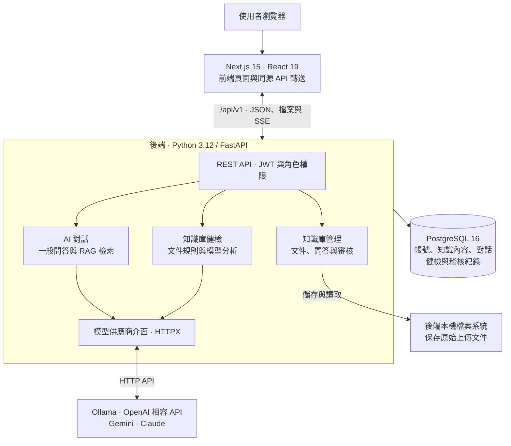
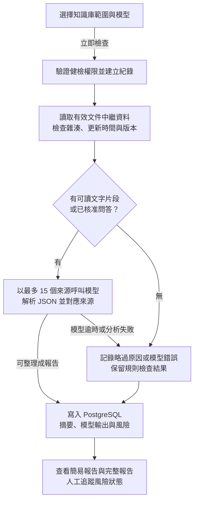

# 企業知識治理平台｜技術架構

平台把文件與問答管理、AI 對話和知識庫健檢放在同一個工作區。兩項 AI 功能共用已生效的知識內容與模型介面。對話依使用者問題尋找來源，健檢則掃描指定範圍的知識風險。

## 系統架構

- **前端與 API**　Next.js App Router、TypeScript 和 Tailwind CSS 負責操作介面。瀏覽器用 `fetch` 呼叫同源 `/api/v1`，Next.js 依伺服器端的 `API_PROXY_TARGET` 轉送給 FastAPI。受保護的請求附上 JWT Bearer 權杖，後端依路由檢查身分及角色權限。
- **資料與檔案**　一般知識庫可上傳與預覽 PDF、DOCX、TXT、MD、CSV，原始檔預設存於後端的 `data/uploads`。PostgreSQL 保存文件中繼資料、SHA-256 雜湊及 TXT、MD、CSV 的文字片段。問答知識庫將 CSV 或 XLSX 匯入為資料列，通過審核後可供檢索及健檢。後端以 SQLAlchemy 和 asyncpg 存取資料庫，Alembic 管理資料表遷移。
- **RAG 對話**　後端依問題詞彙與中文字元組合，在所選知識庫的有效文字片段與已核准問答中用 SQL 字串比對排序，交錯取最多 16 個候選。模型先從摘要挑出最多 5 個相關來源，後端再將來源名稱與內容加入生成上下文。回答透過 SSE 回傳，對話訊息存入 PostgreSQL。模型呼叫由後端依所選供應商發出。

## 知識庫健檢流程

手動健檢由 `POST /api/v1/health-checks/jobs` 在同一請求內完成，前端收到結果後再查詢報告。規則檢查涵蓋範圍內的所有有效文件，找出相同雜湊、超過 180 天未更新或缺少版本的文件。模型分析疑似過期、內容衝突與知識缺漏，結果附上建議與引用，供人工確認。摘要分別記錄檢查範圍與送交模型的來源數。

平台也提供獨立的 RAG 品質測試報告，使用 `/health-checks/rag-tests` 與自己的提示詞。排程健檢由 `run_scheduled_health_checks.py` 讀取到期排程並呼叫同一個健檢服務，部署時可用 cron 或 launchd 定期呼叫該腳本。
